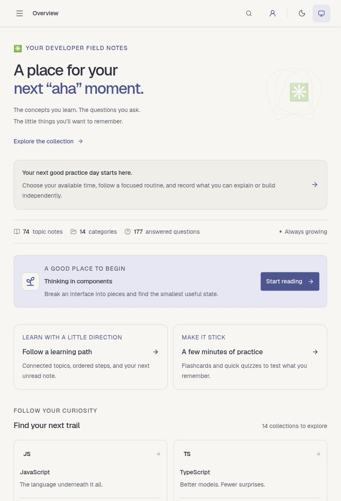
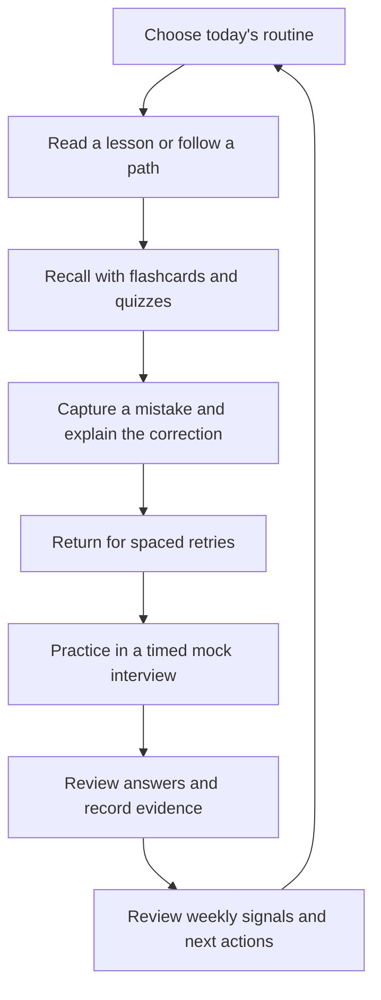
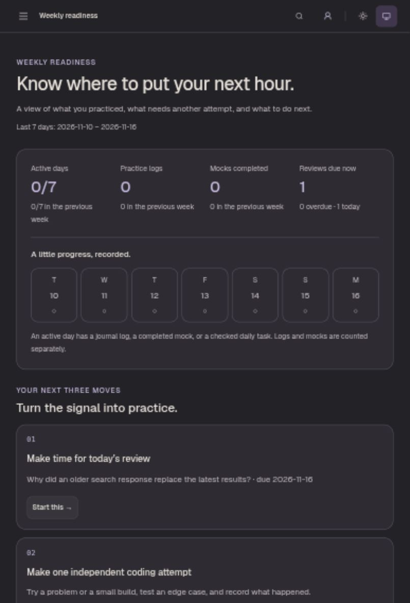
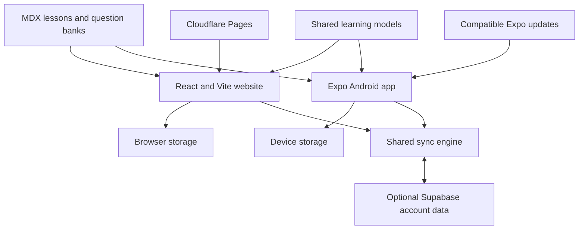

# Dev Trailbook

**A personal workspace for rebuilding developer fundamentals and preparing for interviews.**

I built Dev Trailbook for my own study after a career gap: a place to revisit topics, practice explaining them, learn from mistakes, and build a consistent routine again. It is a personal project shared publicly, and anyone is welcome to use the website for their own preparation.

[Open the website](https://dev-trailbook.pages.dev/) · [Android builds](https://expo.dev/accounts/webhashiras-team/projects/dev-trailbook/builds) · [Mobile guide](docs/mobile-app.md)



## What you can do

| Area                | Included                                                                                                  |
| ------------------- | --------------------------------------------------------------------------------------------------------- |
| Learn               | 74 MDX lessons across 14 categories, learning paths, code examples, important facts, and full-text search |
| Recall              | 177 flashcards and 74 quizzes, with resumable practice sessions                                           |
| Correct mistakes    | A notebook for missed answers, reflections, and spaced retries                                            |
| Rehearse interviews | Timed mock sessions, written answers, self-assessment, and debriefs                                       |
| Build consistency   | Daily routines, practice evidence, due reviews, and weekly readiness signals                              |
| Keep your work      | Local progress, optional account sync, and portable JSON export and restore                               |
| Study comfortably   | Responsive phone, tablet, and desktop layouts; Paper & Indigo light and night themes                      |
| Use Android         | Bundled lessons, optional India-time reminders, a firm or quiet header, and compatible in-app updates     |

Reading and guest practice do not require an account. Guest data stays on that device. Signing in connects supported study records across the website and Android app. Read status and self-assessment are study signals, not a certification or a promise of employment.

## The study loop



The notebook turns missed answers into something to revisit. Mock interviews make room for timed practice and honest reflection. Weekly readiness brings these records together to suggest where the next study session would help.



_Screenshots show the running web application with demonstration study data._

## Architecture

One Bun and Turborepo workspace serves a Vite website and an Android-first Expo app. Shared packages keep lessons, learning rules, and synchronization behavior consistent.



```text
apps/
  web/                 Vite, React, Tailwind, shadcn, and UI SDK
  mobile/              Expo Router app and native device adapters
packages/
  content/             MDX lessons, categories, and generated native content
  learning/            Practice, mistakes, interviews, readiness, and backups
  sync/                Shared record storage and conflict-aware synchronization
supabase/              Database migration and security checks
scripts/               Static hosting build-output preparation
docs/                  Feature guides and screenshots
```

Screens compose reusable components and feature modules. Platform-specific adapters handle files, storage, notifications, and updates. The website uses Tailwind utilities and semantic theme tokens; the native app uses its own shared design tokens and components.

## Run locally

Use **Node.js 24** and **Bun 1.4.4**, matching the project's package manager.

```sh
git clone https://github.com/subhamBharadwaz/dev-trail-book.git
cd dev-trail-book
bun install --frozen-lockfile
bun run dev
```

Open the local address printed by Vite. Guest mode works without a backend connection.

| Command                 | Purpose                                                                    |
| ----------------------- | -------------------------------------------------------------------------- |
| `bun run content`       | Regenerate the native lesson bundle from MDX                               |
| `bun run check`         | Generate content, typecheck, lint, test, and build the website             |
| `bun run test`          | Run the workspace tests                                                    |
| `bun run build`         | Produce the website and repository-root `dist/`                            |
| `bun run dev:mobile`    | Start Metro for an installed development client                            |
| `bun run android`       | Open Android development on a connected device or emulator                 |
| `bun run build:android` | Validate and export an Android Hermes bundle; this does not produce an APK |

### Optional account sync

For your own deployment, create your own Supabase project and apply `supabase/migrations/20261115000100_progress_sync.sql`.

- Website: copy `.env.example` to `.env.local` and set the public `VITE_SUPABASE_URL` and `VITE_SUPABASE_PUBLISHABLE_KEY` values.
- Android: use `apps/mobile/.env.example` for the corresponding `EXPO_PUBLIC_` values.
- Configure allowed web authentication redirects and the native callbacks `devtrailbook://auth/callback` and `devtrailbook-dev://auth/callback`.
- Configure email delivery for the people who will sign in to your instance.

Only public client configuration belongs in application bundles. Database passwords and service-role credentials must never be included. See the [mobile guide](docs/mobile-app.md) for native authentication setup.

## Android development and personal releases

The app uses **Expo SDK 58** and a development client with its required native modules. Use the development APK for Metro-based development rather than relying on Expo Go.

Build profiles live in `apps/mobile/eas.json`. From `apps/mobile`:

```sh
bunx eas-cli@latest build --platform android --profile development
bunx eas-cli@latest build --platform android --profile preview
```

The preview profile produces the personal standalone APK on the `personal` update channel. It is intended for sideloading; a store release is not required for personal use.

After installing the update-enabled APK once, compatible JavaScript, lesson, and asset changes can arrive through Expo updates. The app checks for updates and lets you choose when to restart. Native dependencies, permissions, and SDK changes still require a replacement APK.

Publish a compatible update from the repository root:

```sh
bun run check
bun run update:android --message "Describe the update"
```

Android reminders are optional local notifications at **09:00, 13:00, 17:00, and 21:00 India time**. They are suppressed while the app is open. Opening the app renews a rolling 14-day schedule; device notification permissions and battery settings can affect delivery. The motivational header can be switched to a quiet title. These features are specific to the Android app.

## Deploy the website

For Cloudflare Pages, use the repository root:

| Setting                | Value                                            |
| ---------------------- | ------------------------------------------------ |
| Framework preset       | None                                             |
| Build command          | `bun install --frozen-lockfile && bun run build` |
| Build output directory | `dist`                                           |
| Root directory         | Leave empty                                      |
| Node / Bun             | 24 / 1.4.4                                       |

Set the public Supabase variables in the build environment if account sync is enabled. The configured Git integration deploys changes pushed to `main`. Hash-based routes work on static hosting without server-side route rewrites. The Android app is built separately.

## Your data

- Guest study data stays in local storage. Account data is cached separately for each user and queued for synchronization when offline.
- Supabase row-level security isolates account records. Revision checks expose conflicting edits for an explicit choice instead of silently replacing them.
- Export and restore support study records, including notebook entries and mock interview answers. Restore previews changes and defaults to adding missing records.
- Backups exclude authentication credentials and device preferences. They can still contain personal notes and answers, so keep them private.
- Theme and notification settings are device-specific. The website is not an installable offline PWA; native lessons are bundled in the Android app.

## Add or improve a lesson

Create an MDX file in `packages/content/lessons/`, following an existing lesson's metadata and section structure. Add questions, facts, code examples, and official references; use `quizDistractors` to include its first question in quizzes. Run `bun run content` and `bun run check` before sharing the change. Search and category counts are generated from the content.

Only compile trusted MDX: it can include executable JavaScript and React components.

## Feature guides

- [Mistake notebook](docs/mistake-notebook.md)
- [Timed mock interviews](docs/mock-interviews.md)
- [Weekly readiness](docs/weekly-readiness.md)
- [Backups, updates, and reminders](docs/backups-updates-reminders.md)
- [Android setup and device checks](docs/mobile-app.md)
